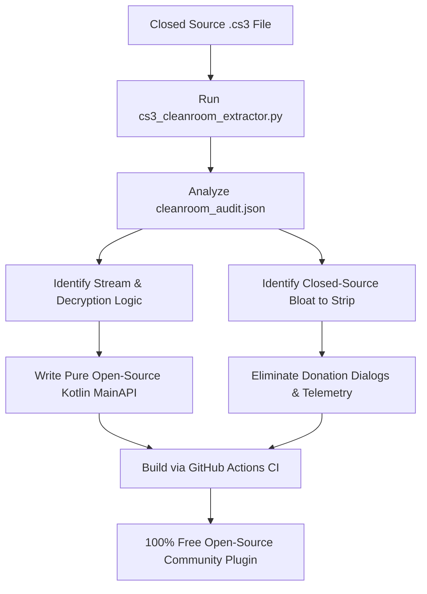

# Cleanroom Reverse Engineering & Open-Sourcing Guide for CloudStream Plugins

This guide explains how to take any closed-source CloudStream 3 / 4 plugin (`.cs3` file), extract its underlying stream resolvers and anti-bot mechanisms, strip proprietary nagware/donation code, and reconstruct a 100% clean, pure open-source Kotlin provider.

---

## 1. What is a `.cs3` File?

A `.cs3` file is simply a standard Android ZIP archive containing:
- `classes.dex`: Compiled Dalvik bytecode of the plugin.
- `manifest.json`: Plugin metadata (name, author, version, description, TV types).
- `res/`: Android UI drawables and layouts (if custom sheets or dialogs are used).
- `resources.arsc`: Compiled Android binary resources.

Many closed-source plugins wrap open-source extractors with:
- Persistent donation modals (`DonationDialogFragment`, `buymeacoffee`, goal trackers).
- Proprietary bottom sheets and webview dialogs.
- Obfuscated resolvers and telemetry.

---

## 2. The Cleanroom Extraction Tool

We have provided a dedicated tool in this repository:
[`tools/cs3_cleanroom_extractor.py`](file:///D:/animepahe/tools/cs3_cleanroom_extractor.py).

### How to Run:
```bash
python tools/cs3_cleanroom_extractor.py <path-to-closed-source-plugin.cs3> --output <output-directory>
```

### Example:
```bash
python tools/cs3_cleanroom_extractor.py "AnimePahe.cs3" --output "./audit_sample"
```

### What the Tool Does:
1. **Parses DEX Bytecode Without Execution**: Safely inspects the Dalvik bytecode without running untrusted code on your system.
2. **Discovers All API Endpoints**: Extracts full URLs, query parameters (`?m=airing`, `?m=release`), and CDN hosts.
3. **Isolates Stream Decryptors**: Detects unpacker routines (`getAndUnpack`), packer patterns (`eval(function(p,a,c,k,e,r)`), and HLS encryption tags (`#EXT-X-KEY:METHOD=AES-128`, `IV=0x`).
4. **Flags Proprietary Bloat**: Highlights telemetry, trackers, and donation packages (`com.*.donation.*`, `goal.json`) so they can be completely removed.
5. **Exports Audit Report**: Generates `cleanroom_audit.json` containing the full analysis for community collaboration.

---

## 3. Step-by-Step Cleanroom Conversion Workflow



### Step 1: Extract Endpoints & Models
From `cleanroom_audit.json`, copy the real API endpoints:
- Latest Releases: `/api?m=airing&page=`
- Search: `/api?m=search&q=`
- Episodes: `/api?m=release&id={session}&sort=episode_asc`

Model the JSON responses using `@JsonProperty` data classes:
```kotlin
data class AiringItem(
    @JsonProperty("anime_title") val animeTitle: String,
    @JsonProperty("episode") val episode: Int?,
    @JsonProperty("snapshot") val snapshot: String?,
    @JsonProperty("anime_session") val animeSession: String
)
```

### Step 2: Handle HLS Stream Decryption (`getVideoInterceptor`)
If the stream uses AES-128 encryption with per-segment IVs (common in Kwik/owocdn), standard ExoPlayer will fail with `ERROR_CODE_PARSING_CONTAINER_MALFORMED (3001)`.
To fix this in open-source code without proprietary libraries:
```kotlin
override fun getVideoInterceptor(extractorLink: ExtractorLink): Interceptor? {
    if (extractorLink.type != ExtractorLinkType.M3U8 && !extractorLink.url.contains(".m3u8")) {
        return null
    }
    return Interceptor { chain ->
        val request = chain.request()
        val reqBuilder = request.newBuilder()
        if (request.header("Referer").isNullOrBlank()) {
            reqBuilder.header("Referer", "https://kwik.cx/")
        }
        val response = chain.proceed(reqBuilder.build())
        if (!request.url.encodedPath.endsWith(".m3u8")) return@Interceptor response

        val body = response.body ?: return@Interceptor response
        val contentType = body.contentType()
        val bodyStr = body.string()

        if (bodyStr.contains("#EXT-X-KEY:METHOD=AES-128") && !bodyStr.contains(",IV=0x")) {
            val fixed = fixHlsAesSequenceIvs(bodyStr)
            response.newBuilder()
                .body(fixed.toByteArray(Charsets.UTF_8).toResponseBody(contentType))
                .build()
        } else {
            response.newBuilder()
                .body(bodyStr.toByteArray(Charsets.UTF_8).toResponseBody(contentType))
                .build()
        }
    }
}
```

Where `fixHlsAesSequenceIvs` injects the sequence IV:
```kotlin
fun fixHlsAesSequenceIvs(m3u8: String): String {
    val keyRegex = Regex("""^#EXT-X-KEY:METHOD=AES-128,URI="([^"]+)"(?:\s*)$""")
    val segRegex = Regex("""segment-(\d+)-""")
    var currentKeyUri: String? = null
    val sb = StringBuilder(m3u8.length)

    for (line in m3u8.lines()) {
        val trimmed = line.trim()
        val keyMatch = keyRegex.find(trimmed)
        if (keyMatch != null) {
            currentKeyUri = keyMatch.groupValues[1]
            continue
        }
        if (currentKeyUri != null && !trimmed.startsWith("#") && trimmed.isNotBlank()) {
            val segMatch = segRegex.find(trimmed)
            val segNum = segMatch?.groupValues?.getOrNull(1)?.toLongOrNull()
            if (segNum != null) {
                val ivHex = segNum.toString(16).padStart(32, '0')
                sb.append("""#EXT-X-KEY:METHOD=AES-128,URI="$currentKeyUri",IV=0x$ivHex""").append('\n')
            }
        }
        sb.append(line).append('\n')
    }
    return sb.toString().trimEnd()
}
```

### Step 3: Handle Cloudflare Turnstile Verification Natively
Instead of proprietary sub-sheets, use Android's native `WebView` and `CookieManager`:
1. When Cloudflare responds with `403 / 503` or challenge HTML, launch a standard Android dialog with a `WebView`.
2. Emulate genuine mobile touch events and natural cursor positioning.
3. When `cf_clearance` cookie is issued by Cloudflare, poll it via `CookieManager.getInstance().getCookie(...)`.
4. Synchronize the clearance cookie across all subdomains (`animepahe.pw`, `i.animepahe.pw`, etc.) into CloudStream's `app.baseClient.cookieJar`.
5. Dismiss the dialog and resume the background coroutine. Zero tracking, zero third-party dependencies.

### Step 4: Fix Image Resolution for CloudStream UI
- **Episode Snapshots**: AnimePahe appends `.sm.webp` to thumbnails (330x185 px). For the Hero Billboard (1080p full bleed), strip `.sm`:
  ```kotlin
  fun fixImageUrl(url: String?): String? {
      if (url.isNullOrBlank()) return null
      return url.replace(Regex("""\.sm(\.[a-zA-Z0-9]+)$"""), "$1")
  }
  ```
- **Image Headers**: Pass Cloudflare cookies and browser subresource headers (`Sec-Fetch-Dest: image`, `Referer`) via `posterHeaders` so Coil loads images without HTTP 403.

### Step 5: Strip All Closed-Source Bloat
Discard the following:
- Delete any package named `*.donation.*`, `DonationManager`, `DonationDialogFragment`.
- Delete any network requests to `buymeacoffee.com`, `ko-fi.com`, or custom donation workers.
- Delete any proprietary layout XML files (`cf_sheet_layout.xml`, `dialog_background.xml`).

---

## 4. Building & Publishing

Compile your clean open-source plugin using CloudStream's Gradle Plugin:
```bash
./gradlew :AnimePaheProvider:make makePluginsJson
```
Artifacts (`.cs3` and `plugins.json`) will be produced in `build/` and ready for inclusion in any CloudStream extension repository.
