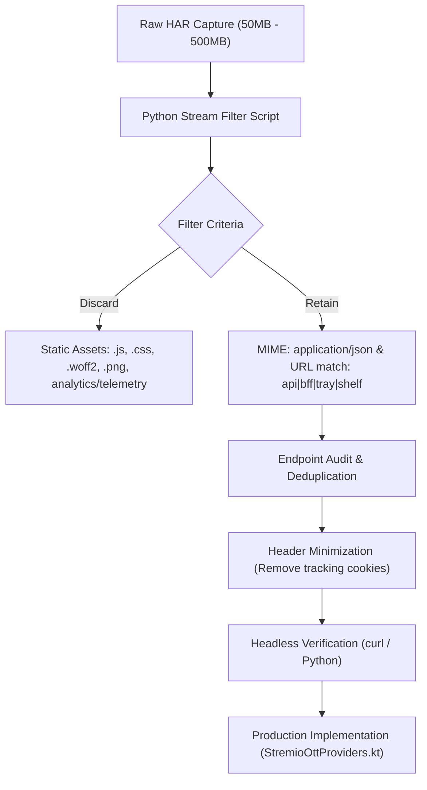
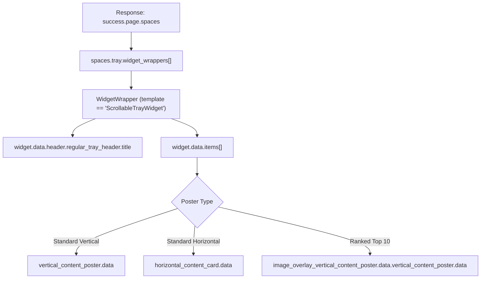
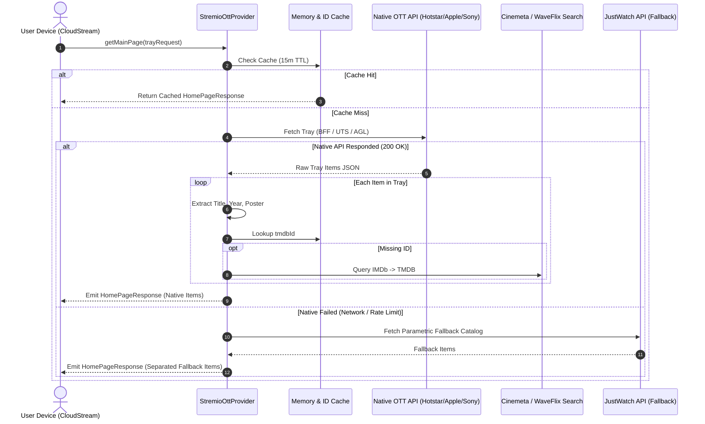

# Reverse-Engineering Native OTT APIs from HAR Network Captures: Complete Engineering Protocol

> **Target Audience**: AI Agents, Systems Engineers, and Security Researchers maintaining or extending CloudStream/Stremio provider extensions.  
> **Target Platforms**: **JioHotstar**, **Apple TV+**, **SonyLIV**.  
> **Source Files**: `returnpilot_network_www_hotstar_com_*.har`, `returnpilot_network_tv_apple_com_*.har`, and native web inspector session logs.

---

## 1. Executive Summary & Purpose

Modern streaming media applications (OTTs) rely on Single Page App (SPA) frontends (React, Angular, Next.js) backed by Backend-for-Frontend (BFF) gateways or edge microservices. Instead of scraping fragile HTML DOM trees with CSS selectors, extracting **native REST/BFF JSON endpoints** yields:
1. **Zero DOM Fragility**: Immune to frontend CSS re-writes, Tailwind class changes, and obfuscation.
2. **Rich Metadata**: High-resolution poster CDN URLs, release dates, exact content taxonomy, and canonical identifiers (IMDb `tt` IDs, TMDB IDs).
3. **High Performance**: Lightweight JSON payloads (10-50 KB) instead of megabytes of bloated HTML/JS.
4. **Guest Session Tolerant**: Access to catalog shelves and top 10 trends without requiring paid user credentials.

This document describes the exact forensic methodology used to dissect HTTP Archive (`.har`) files and reverse-engineer the native APIs of **JioHotstar**, **Apple TV+**, and **SonyLIV**.

---

## 2. Universal HAR Forensic Toolkit & Protocol

HAR files captured from real user browser sessions typically range from **50 MB to 600 MB**. Attempting to load an entire HAR into memory or opening it in standard text editors often results in browser freezes or OOM crashes.



### 2.1 Reusable Python HAR Extraction Script
Use this script to extract and summarize candidate API endpoints from any HAR file:

```python
import json
import sys
import re

# Ensure UTF-8 output on Windows
sys.stdout.reconfigure(encoding='utf-8')

HAR_FILE = sys.argv[1] if len(sys.argv) > 1 else "network_capture.har"

IGNORE_EXTENSIONS = ('.js', '.css', '.png', '.jpg', '.jpeg', '.svg', '.woff2', '.ttf', '.gif', '.ico')
ANALYTICS_DOMAINS = ('segment.io', 'newrelic.com', 'conviva.com', 'moengage.com', 'google-analytics.com', 'doubleclick.net', 'scorecardresearch.com')

print(f"[*] Analyzing HAR: {HAR_FILE}")

with open(HAR_FILE, 'r', encoding='utf-8', errors='ignore') as f:
    har = json.load(f)

entries = har.get('log', {}).get('entries', [])
print(f"[*] Total entries found: {len(entries)}")

candidate_endpoints = []

for idx, entry in enumerate(entries):
    req = entry.get('request', {})
    res = entry.get('response', {})
    url = req.get('url', '')
    method = req.get('method', 'GET')
    status = res.get('status', 0)
    mime = res.get('content', {}).get('mimeType', '')

    # Filter out noise
    if any(url.lower().endswith(ext) for ext in IGNORE_EXTENSIONS):
        continue
    if any(domain in url.lower() for domain in ANALYTICS_DOMAINS):
        continue
    if status < 200 or status >= 400:
        continue

    # Filter for JSON or catalog keywords
    if 'json' in mime.lower() or any(k in url.lower() for k in ['api', 'bff', 'tray', 'shelf', 'collection', 'slug']):
        headers = {h['name']: h['value'] for h in req.get('headers', [])}
        res_text = res.get('content', {}).get('text', '')
        size = len(res_text)

        candidate_endpoints.append({
            'index': idx,
            'method': method,
            'url': url,
            'status': status,
            'size': size,
            'headers': headers,
            'sample_body': res_text[:300] if res_text else ""
        })

print(f"[+] Isolated {len(candidate_endpoints)} API candidate endpoints.\n")
for ep in candidate_endpoints[:20]:
    print(f"[{ep['method']}] {ep['status']} ({ep['size']} bytes) -> {ep['url']}")
```

---

## 3. JioHotstar (`www.hotstar.com`) Reverse-Engineering

### 3.1 HAR Source File
* **Source Capture**: `E:\Election 2018\sdd\returnpilot_network_www_hotstar_com_1792747976812.har`

### 3.2 Finding the BFF Endpoint
Filtering the HAR for domain `hotstar.com` and `json` responses revealed a unified Backend-For-Frontend (BFF) layout architecture:

$$\text{Endpoint Pattern: } \texttt{GET https://www.hotstar.com/api/internal/bff/v2/slugs/in/\{page\_slug\}}$$

Supported `page_slug` values:
* `home` - Main homepage trays
* `movies` - Movie catalog trays
* `shows` - TV Series & Drama catalog trays
* `sports` - Live & upcoming sports fixtures

### 3.3 Header Analysis & Guest Authentication
In the HAR capture, browser requests to the BFF API sent numerous headers. Through step-by-step minimization, the mandatory header contract was isolated:

| Header | Value | Requirement | Purpose |
| :--- | :--- | :--- | :--- |
| `x-hs-usertoken` | `eyJhbGciOiJIUzI1NiJ9...` | **Mandatory** | Hotstar Guest Session JWT token. Valid for catalog read queries. |
| `X-HS-Platform` | `web` | **Mandatory** | Identifies client layout format. |
| `X-Country-Code` | `in` | **Mandatory** | Sets regional catalog to India (IN). |
| `Accept` | `application/json, text/plain, */*` | Recommended | Standard REST accept header. |
| `User-Agent` | Desktop Chrome UA | Recommended | Avoids edge bot heuristics. |

> [!NOTE]
> The `x-hs-usertoken` is a **Guest JWT** issued automatically by Hotstar's user-management service (`UM`) to unauthenticated visitors. It contains payload claims `{"customerType":"nu", "type":"guest", "countryCode":"in", "profile":"ADULT"}` and allows infinite read operations on catalog slugs.

### 3.4 Response Schema Navigation
Hotstar's BFF payload uses a nested "space and widget" layout hierarchy:



#### Key JSON Fields Extracted:
1. **Tray Title**: `widget.data.header.regular_tray_header.title`  
   *Examples*: `"Top 10 in India Today - Hindi"`, `"Popular Movies on JioHotstar"`, `"Best of Bollywood Movies"`, `"Best of Hollywood Dubbed"`, `"Must Watch Hotstar Specials"`.
2. **Item Data Extraction**:
   ```kotlin
   val posterData = itemWrapper.verticalPoster?.data
       ?: itemWrapper.horizontalCard?.data
       ?: itemWrapper.overlayPoster?.data?.verticalPoster?.data
   ```
3. **Content Title**: `posterData.expandedPoster?.contentInfo?.title ?: posterData.image?.alt`
4. **Release Year**: Parsed from `posterData.expandedPoster?.contentInfo?.tags[].value` (e.g. `"2024"`).
5. **Image CDN Construction**:
   - `posterData.image.src` returns relative hash: `sources/r1/cms/prod/8254/1728254-v-c87...`
   - Complete CDN URL: `https://img.hotstar.com/image/upload/v1/{image.src}`

---

## 4. Apple TV+ (`tv.apple.com`) Reverse-Engineering

### 4.1 HAR Source File
* **Source Capture**: `E:\Election 2018\sdd\returnpilot_network_tv_apple_com_1792750271629.har`

### 4.2 The "400 Bad Request" Trap vs. iTunes UTS Edge API
Initial attempts to query Apple TV's web BFF origin directly (`https://tv.apple.com/api/uts/v3/shelves/...`) failed outside the browser with **HTTP 400 Bad Request** due to missing internal WebKit state cookies, browser fingerprint headers, and cross-site request tokens.

However, deep inspection of the HAR network entries revealed that media apps and Apple TV web clients query Apple's **Universal Media Service (UTS) edge API**:

$$\text{Public Edge URL: } \texttt{GET https://uts-api.itunes.apple.com/uts/v3/shelves/\{shelf\_id\}}?caller=web\&sf=143467\&v=72\&pfm=web\&locale=en-IN\&utsk=\{utsk\}$$

### 4.3 URL Parameter Breakdown
* `sf=143467`: Storefront Identifier for **India (IN)**. (US Storefront is `143441`).
* `locale=en-IN`: Enforces English localization with Indian market ratings.
* `v=72`: UTS API schema version.
* `pfm=web`: Platform identifier (`web`).
* `caller=web`: Client identity.
* `utsk=6e3013c6d6fae3c2::::::`: Apple's public guest storefront session token. Works publicly without login cookies.

### 4.4 Discovered Shelf IDs
From the HAR traffic, the complete list of verified Apple TV+ shelves was cataloged:

| Shelf ID | Shelf Title / Category | Sample Content |
| :--- | :--- | :--- |
| `uts.col.ChartsMovies.tvs.sbd.4000` | **Top 10 Movies Today** | *Tenzing*, *F1 The Movie*, *Matchbox*, *Wolfs* |
| `uts.col.ChartsShows.tvs.sbd.4000` | **Top 10 Shows Today** | *Slow Horses*, *Ted Lasso*, *Dark Matter*, *Silo* |
| `uts.col.tv-plus-must-see-hits` | **Must-See Blockbusters** | *Severance*, *Morning Show*, *Foundation* |
| `uts.col.tv-plus-newest-releases` | **New Releases** | *Disclaimer*, *Bad Monkey*, *Fly Me to the Moon* |
| `uts.col.apple-tv-movies-action` | **Action & Thriller Movies** | *Killers of the Flower Moon*, *Ghosted*, *Greyhound* |
| `uts.col.apple-tv-movies-comedies` | **Comedies** | *The Family Plan*, *Spirited*, *Palm Springs* |
| `uts.col.apple-tv-movies-dramas` | **Acclaimed Dramas** | *CODA*, *Napoleon*, *Cherry* |
| `uts.col.kids-tv-plus-shows` | **Kids & Family** | *Peanuts*, *Fraggle Rock*, *Duck & Goose* |
| `uts.col.free-premieres-on-tv-plus` | **Free Pilot Episodes** | Season 1 Episode 1 previews |

### 4.5 Image URL Template Resolution
Apple's image URLs in the UTS JSON response contain a dynamic resolution template:
```json
"url": "https://is1-ssl.mzstatic.com/image/thumb/Video126/v4/.../cover.jpg/{w}x{h}.{f}"
```
To obtain high-resolution WebP posters for mobile and TV displays, replace `{w}x{h}.{f}`:
```kotlin
val rawPoster = item.images?.shelfImage?.url ?: item.images?.transitionImage?.url
val poster = rawPoster?.replace("{w}x{h}.{f}", "720x1080.webp")
```

---

## 5. SonyLIV (`www.sonyliv.com`) Reverse-Engineering

### 5.1 Endpoint Architecture
SonyLIV uses its Application Gateway Layer (AGL) REST service:

$$\text{Collection Endpoint: } \texttt{GET https://apiv3.sonyliv.com/AGL/4.8/A/ENG/WEB/IN/CT/TRAY/EXTCOLLECTION/\{tray\_id\}?from=0\&to=\{count\}}$$
$$\text{Popular Search Endpoint: } \texttt{GET https://apiv3.sonyliv.com/AGL/4.8/A/ENG/WEB/IN/CT/TRAY/SEARCH/POPULAR?from=0\&to=\{count\}}$$

### 5.2 Mandatory Security Headers
SonyLIV's API gateway enforces strict CORS origin checks. Omission of `Origin` or `Referer` results in **HTTP 403 Forbidden**:

```http
GET /AGL/4.8/A/ENG/WEB/IN/CT/TRAY/EXTCOLLECTION/9014011?from=0&to=15 HTTP/1.1
Host: apiv3.sonyliv.com
Origin: https://www.sonyliv.com
Referer: https://www.sonyliv.com/
User-Agent: Mozilla/5.0 (Windows NT 10.0; Win64; x64) AppleWebKit/537.36 ...
```

### 5.3 Verified Tray Collection IDs

| Tray ID | Category | Content Focus |
| :--- | :--- | :--- |
| `9014011` | **Trending in India Today** | Top regional films, latest episodes |
| `9015093` | **Popular SonyLIV Originals** | *Scam 1992*, *Gullak*, *Rocket Boys*, *Maharani* |
| `9016638` | **Blockbuster Movies** | Hindi, South, and Hollywood titles |
| `POPULAR_SEARCH` | **Popular on Sony SAB & TV** | *Taarak Mehta Ka Ooltah Chashmah*, *CID*, *Crime Patrol* |
| `3937924064` | **Trending in Sports** | UEFA Champions League, Cricket Highlights, WWE |
| `9012681` | **Upcoming on LIV** | Trailers and upcoming releases |

### 5.4 The Canonical Anchor: IMDb ID in `emfAttributes.SameAs`
A major obstacle in scrapers is matching regional Indian titles (which often have inconsistent transliterations like *Gullak*, *Gulak*, *Gullak Season 4*) with external streaming sources.

Deep inspection of SonyLIV's `metadata.emfAttributes` revealed that Sony includes the official IMDb URI:
```json
"emfAttributes": {
    "SameAs": [
        "https://www.imdb.com/title/tt11663228/"
    ],
    "tvBackgroundImage": "https://images.slivcdn.com/...",
    "imgTile38402160": "https://images.slivcdn.com/..."
}
```
**Advantage**: By extracting `tt11663228` from `SameAs`, the provider queries Cinemeta (`https://v3-cinemeta.strem.io/meta/series/tt11663228.json`) and resolves the exact canonical TMDB ID without performing error-prone fuzzy text searches!

### 5.5 Live TV Streams: Direct Akamai CDN vs. Reverse Proxies
Network traces for Live TV channels (Sony Sports TEN, Sony SAB) revealed direct Akamai CDN HLS manifests:
```text
https://sonydaime.akamaized.net/hls/live/.../master.m3u8
```
**Critical Invariant**:
- Direct Akamai streams must always be sorted **ahead** of third-party proxy bridges (such as CNCverse `/d/master.m3u8`) in `loadLinks()`.
- Third-party proxies frequently fail with `416 Range Not Satisfiable` on player init fragments (`/d/init`), causing ExoPlayer to crash with error code `2004` (bad HTTP status). Direct CDN streams play stably with zero player stalls.

---

## 6. Amazon Prime Video (`www.primevideo.com`) Reverse-Engineering

### 6.1 HAR Source File
* **Source Capture**: `C:\Users\SANCHAR\Downloads\www.primevideo.com.har` (43.4 MB, 245 network entries)

### 6.2 Architecture: Two-Tier SSR + REST Pagination
Prime Video implements a hybrid architecture:
1. **Tier 1 (Initial Page Load - SSR Embedded State)**:
   - Request: `GET https://www.primevideo.com/` (HTTP 200, 1.42 MB HTML).
   - In the HTML, an embedded `<script>` tag contains the full serialized React initial state:
     `{"init": {"path": "/storefront", "preparations": {"body": {"containers": [...]}}}}`
   - Yields the first 7 primary carousels and the pagination token (`serviceToken`).
2. **Tier 2 (Infinite Scroll REST API - `/api/getLandingPage`)**:
   - Request: `POST https://www.primevideo.com/api/getLandingPage?`
   - Content-Type: `application/x-www-form-urlencoded`
   - Payload:
     `pageType=home&pageId=home&pageNumber=2&pageSize=14&startIndex=9&serviceToken={serviceToken}&targetId={targetId}&decorationScheme=web-decoration-gti-v4&featureScheme=web-features-v6`
   - Yields pure JSON (762 KB) with 12 additional carousels.

### 6.3 Authentication & CloudFront WAF Invariants
* **Zero Cookies / Public Guest Session**: The HAR capture confirmed that **0 cookies** are needed for storefront queries. Prime Video serves public catalogs anonymously without user login.
* **WAF Header Requirements**: Amazon's CloudFront WAF checks for standard browser Client Hints and Sec-Fetch headers. To prevent `HTTP 503: Service Temporarily Unavailable`, clients must send:
  - `User-Agent`: Desktop Chrome UA
  - `Referer`: `https://www.google.com/`
  - `sec-ch-ua`: `"Chromium";v="124", "Google Chrome";v="124", "Not-A.Brand";v="99"`
  - `sec-fetch-dest`: `document`
  - `sec-fetch-mode`: `navigate`
  - `sec-fetch-site`: `cross-site`

### 6.4 Catalog Trays & Content Taxonomy Discovered

| Tray Identifier | Type | Title in UI | Sample Titles |
| :--- | :--- | :--- | :--- |
| **Page 2 - Tray 5** | `Charts` | **Top 10 with Prime** | *Rise And Fall*, *Jailer*, *Lenin Pandiyan*, *Chaar Yaar*, *Dupahiya* |
| **Page 1 - Tray 2** | `StandardCarousel` | **Trending Movies: Watch for Free** | *Jailer*, *Drishyam 2 (Hindi)*, *Pushpa: The Rise*, *Vettaiyan* |
| **Page 1 - Tray 3** | `StandardCarousel` | **Blockbuster Movies** | *Jailer*, *Khalifa*, *Sardar 2*, *Pushpa: The Rise* |
| **Page 1 - Tray 5** | `SuperCarousel` | **Featured Originals: Series** | *Duniya Ki Thain Thain*, *Dupahiya*, *Rise And Fall*, *Mirzapur* |
| **Page 2 - Tray 6** | `SuperCarousel` | **Featured Originals: Movies** | *Masterplan*, *Love Of Your Life*, *My Fault*, *Your Fault*, *Red One* |
| **Page 2 - Tray 2** | `StandardCarousel` | **Cop Universe** | *Drishyam 2 (Hindi)*, *Waiting Hai*, *Rahasya*, *Section 375*, *B.A. Pass* |
| **Page 2 - Tray 8** | `StandardCarousel` | **Top movies** | *Awarapan 2*, *Khalifa*, *Sardar 2*, *Lenin Pandiyan*, *O'Romeo* |
| **Page 2 - Tray 10** | `StandardCarousel` | **Popular Action Movies** | *The Lake*, *Security*, *The Boy*, *The Dead Lands* |
| **Page 2 - Tray 11** | `StandardCarousel` | **Korean dramas** | *True Beauty*, *GOOD BOY*, *Guardian: The Lonely And Great God* |

### 6.5 Entity Schema & Poster CDN
Inside each container `entities[]`:
* **Title**: `displayTitle` or `title`
* **Release Year**: `releaseYear` (integer e.g. `2024`)
* **ASIN / Identifier**: Extracted from `link.url` (e.g. `/detail/0HNZIYOI76383DKI61QMTROL4K`)
* **Poster CDN**: `images.cover.url` -> `https://m.media-amazon.com/images/S/pv-target-images/{hash}._UR1920,1080_.jpg`

---

## 7. End-to-End CloudStream Provider Integration



---

## 8. Verification Checklist for New HAR Audits

When inspecting future HAR captures from OTT platforms, follow this checklist:

1. [ ] **Stream-Process the HAR**: Do not load raw JSON into standard text editors. Use `json.load()` with selective key extraction.
2. [ ] **Discard Static Telemetry**: Filter out Segment, NewRelic, Conviva, MoEngage, and font/css assets.
3. [ ] **Identify BFF & REST Hubs**: Look for endpoints containing `slug`, `tray`, `shelf`, `collection`, `page`, or `layout`.
4. [ ] **Extract Minimal Headers**:
   - Test if the endpoint works without cookies.
   - Retain only `x-hs-usertoken` (Hotstar), `utsk` (Apple), or `Origin`/`Referer` (SonyLIV).
5. [ ] **Verify Edge Endpoints vs. Web Origin**: If the primary web origin returns `400` or `403` (like `tv.apple.com`), inspect other traffic to find public media edge domains (`uts-api.itunes.apple.com`).
6. [ ] **Locate Canonical Metadata**: Look inside metadata containers for IMDb links (`SameAs`), EIDR identifiers, or TMDB IDs.
7. [ ] **Implement Dynamic Period/Regional Logic**: Never hardcode regional IDs; parameterize by country code (`IN`, `US`) and tax/storefront codes (`sf=143467`).
8. [ ] **Validate with `node --check` / Kotlin Compile**: Always ensure zero syntax errors and verify payload parsing defensively with nullable fallback chains.
