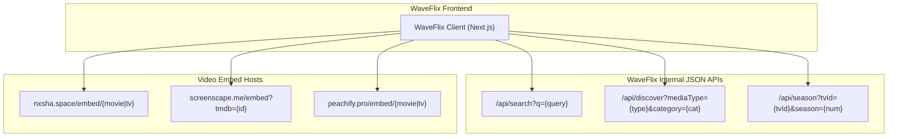
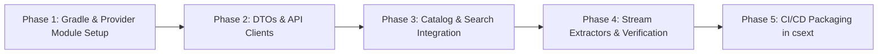

# WaveFlix CloudStream Provider (`WaveFlixProvider`) Scraping & Implementation Plan

This plan outlines the architecture, reverse-engineered API specifications, and phased implementation blueprint for developing a high-performance, requests-based CloudStream provider for **[waveflix.online](https://www.waveflix.online/)** in accordance with the [CloudStream Scraping Tutorial](https://cloudstream.miraheze.org/wiki/Scraping_tutorial) and the [CloudStream Developer Documentation](https://recloudstream.github.io/csdocs/devs/create-your-own-providers/).

---

## 1. Executive Summary & Site Architecture Audit

WaveFlix is a modern Next.js (App Router) web application deployed on Vercel. Unlike traditional pirate streaming websites that render complex server-side HTML with obfuscated DOM structures or require heavy headless browsers/Selenium, **WaveFlix operates entirely as a clean, RESTful TMDB proxy frontend**.



### Key Technical Findings:
1. **Zero Cloudflare Bot-Fight Wall**: The domain is served directly over Vercel's global edge network without Cloudflare Turnstile or anti-bot challenge interstitial pages on its API routes.
2. **Pure JSON API Endpoints**: All content catalog queries (search, trending, category discovery, TV episode listings) are served by internal JSON endpoints (`/api/search`, `/api/discover`, `/api/season`).
3. **Universal TMDB Canonical IDs**: Media identifiers throughout WaveFlix match standard TheMovieDatabase (TMDB) IDs (`1003596`, `120911`, etc.).
4. **Decoupled Multi-Server Video Delivery**: The site does not host video assets directly; it routes media requests to external embed providers (`nxsha.space`, `screenscape.me`, `peachify.pro`) indexed by TMDB parameters.

---

## 2. Reverse-Engineered WaveFlix API Specification

### 2.1 Search API
* **Endpoint**: `GET https://www.waveflix.online/api/search?q={query}`
* **Headers**: `User-Agent: Mozilla/5.0 ...`
* **Response Structure**:
```json
{
  "results": [
    {
      "id": 1003596,
      "mediaType": "movie",
      "title": "Avengers: Doomsday",
      "overview": "Beloved heroes from three distinct universes...",
      "posterPath": "/jzPwsojjFStf5lR5Nm07w2hH56G.jpg",
      "backdropPath": "/g3gpP5YDbA85DsA0bt5mgGQIe5q.jpg",
      "rating": 8.4,
      "releaseDate": "2026-12-16",
      "genreIds": [878, 28, 12],
      "popularity": 817.934
    }
  ],
  "totalPages": 1
}
```
* **Poster URL Resolution**: `https://image.tmdb.org/t/p/w500${posterPath}`.

---

### 2.2 Homepage & Discovery API
* **Endpoint**: `GET https://www.waveflix.online/api/discover?mediaType={type}&category={category}&page={page}`
* **Parameters**:
  - `mediaType`: `movie` | `tv` | `anime`
  - `category`:
    - Movies: `trending`, `now_playing`, `top_rated`, `popular`
    - TV Shows: `trending`, `on_the_air`, `top_rated`, `popular`
  - `page`: `1`, `2`, `3` ...
* **Response Structure**:
```json
{
  "results": [
    {
      "id": 969681,
      "mediaType": "movie",
      "title": "Spider-Man: Brand New Day",
      "overview": "Fighting crime full-time as Spider-Man...",
      "posterPath": "/w1280_poster.jpg",
      "rating": 7.9
    }
  ],
  "page": 1,
  "totalPages": 500
}
```

---

### 2.3 TV Seasons & Episodes API
* **Endpoint**: `GET https://www.waveflix.online/api/season?tvId={tvId}&season={seasonNumber}`
* **Response Structure**:
```json
{
  "id": 120911,
  "season_number": 1,
  "episodes": [
    {
      "episode_number": 1,
      "name": "The Engram",
      "overview": "In the wake of a disastrous mission overseas...",
      "still_path": "/path_to_still.jpg",
      "air_date": "2022-07-01",
      "vote_average": 7.8
    }
  ]
}
```

---

### 2.4 Video Embed Server Routing
Extracted from WaveFlix client bundle `page-0e94ceeeeeb927bd.js`:

| Server Name | ID | Movie Embed URL | TV Episode Embed URL |
| :--- | :--- | :--- | :--- |
| **Nxsha** | `nxsha` | `https://nxsha.space/embed/movie/{tmdbId}` | `https://nxsha.space/embed/tv/{tmdbId}/{season}/{episode}` |
| **ScreenScape** | `screenscape` | `https://screenscape.me/embed?tmdb={tmdbId}&type=movie` | `https://screenscape.me/embed?tmdb={tmdbId}&type=tv&s={season}&e={episode}` |
| **Peachify** | `peachify` | `https://peachify.pro/embed/movie/{tmdbId}` | `https://peachify.pro/embed/tv/{tmdbId}/{season}/{episode}` |

---

## 3. CloudStream Provider Implementation Architecture

### 3.1 DTO (Data Transfer Object) Models
Kotlin data classes mapped to WaveFlix's JSON response payloads:

```kotlin
package com.lagradost

import com.fasterxml.jackson.annotation.JsonProperty

data class WaveSearchResponse(
    @JsonProperty("results") val results: List<WaveMediaItem>? = null,
    @JsonProperty("totalPages") val totalPages: Int? = null
)

data class WaveMediaItem(
    @JsonProperty("id") val id: Long,
    @JsonProperty("mediaType") val mediaType: String? = null,
    @JsonProperty("title") val title: String? = null,
    @JsonProperty("name") val name: String? = null,
    @JsonProperty("overview") val overview: String? = null,
    @JsonProperty("posterPath") val posterPath: String? = null,
    @JsonProperty("backdropPath") val backdropPath: String? = null,
    @JsonProperty("rating") val rating: Double? = null,
    @JsonProperty("releaseDate") val releaseDate: String? = null,
    @JsonProperty("firstAirDate") val firstAirDate: String? = null
)

data class WaveSeasonResponse(
    @JsonProperty("episodes") val episodes: List<WaveEpisodeItem>? = null
)

data class WaveEpisodeItem(
    @JsonProperty("episode_number") val episodeNumber: Int,
    @JsonProperty("name") val name: String? = null,
    @JsonProperty("overview") val overview: String? = null,
    @JsonProperty("still_path") val stillPath: String? = null,
    @JsonProperty("vote_average") val voteAverage: Double? = null
)

data class WaveLoadData(
    val id: Long,
    val mediaType: String,
    val title: String,
    val posterUrl: String?
)
```

---

### 3.2 Core `MainAPI` Methods

#### A. Main Page Discovery (`getMainPage`)
```kotlin
override val hasMainPage = true

override val mainPage = mainPageOf(
    "movie" to "trending" to "Trending Movies",
    "movie" to "now_playing" to "Now Playing Movies",
    "movie" to "top_rated" to "Top Rated Movies",
    "tv" to "trending" to "Trending TV Shows",
    "tv" to "on_the_air" to "TV Shows On Air",
    "anime" to "trending" to "Anime"
)

override suspend fun getMainPage(page: Int, request: MainPageRequest): HomePageResponse {
    val (mediaType, category) = request.data.split("|")
    val url = "$mainUrl/api/discover?mediaType=$mediaType&category=$category&page=$page"
    val res = app.get(url).parsedSafe<WaveSearchResponse>() ?: throw ErrorLoadingException()

    val homeItems = res.results?.mapNotNull { item ->
        item.toSearchResponse()
    } ?: emptyList()

    return newHomePageResponse(request.name, homeItems, hasNext = page < (res.totalPages ?: 1))
}
```

#### B. Search (`search`)
```kotlin
override suspend fun search(query: String): List<SearchResponse> {
    val url = "$mainUrl/api/search?q=${query.encodeUri()}"
    val res = app.get(url).parsedSafe<WaveSearchResponse>() ?: return emptyList()

    return res.results?.mapNotNull { item ->
        item.toSearchResponse()
    } ?: emptyList()
}
```

#### C. Details & Episodes Loading (`load`)
```kotlin
override suspend fun load(url: String): LoadResponse {
    // URL schema: waveflix://movie/{id} or waveflix://tv/{id}
    val uri = URI(url)
    val mediaType = uri.host // "movie" or "tv"
    val id = uri.path.removePrefix("/").toLong()

    if (mediaType == "movie") {
        // Build MovieLoadResponse
        return newMovieLoadResponse(title, url, TvType.Movie, dataUrl) {
            this.posterUrl = poster
            this.plot = overview
        }
    } else {
        // Fetch TV Seasons and episodes
        val episodes = mutableListOf<Episode>()
        var seasonNum = 1
        while (true) {
            val seasonRes = app.get("$mainUrl/api/season?tvId=$id&season=$seasonNum")
                .parsedSafe<WaveSeasonResponse>()
            val eps = seasonRes?.episodes
            if (eps.isNullOrEmpty()) break

            eps.forEach { ep ->
                episodes.add(
                    newEpisode(
                        EpisodeData(id, seasonNum, ep.episodeNumber)
                    ) {
                        this.name = ep.name
                        this.season = seasonNum
                        this.episode = ep.episodeNumber
                        this.posterUrl = "https://image.tmdb.org/t/p/w500${ep.stillPath}"
                        this.description = ep.overview
                    }
                )
            }
            seasonNum++
        }
        return newTvSeriesLoadResponse(title, url, TvType.TvSeries, episodes)
    }
}
```

#### D. Stream Extraction (`loadLinks`)
```kotlin
override suspend fun loadLinks(
    data: String,
    isCasting: Boolean,
    subtitleCallback: (SubtitleFile) -> Unit,
    callback: (ExtractorLink) -> Unit
): Boolean {
    val media = parseJson<MediaLinkData>(data)
    
    // Server 1: Nxsha
    val nxshaUrl = if (media.isMovie) 
        "https://nxsha.space/embed/movie/${media.tmdbId}"
    else 
        "https://nxsha.space/embed/tv/${media.tmdbId}/${media.season}/${media.episode}"
    loadExtractor(nxshaUrl, "https://www.waveflix.online/", subtitleCallback, callback)

    // Server 2: ScreenScape
    val ssUrl = if (media.isMovie)
        "https://screenscape.me/embed?tmdb=${media.tmdbId}&type=movie"
    else
        "https://screenscape.me/embed?tmdb=${media.tmdbId}&type=tv&s=${media.season}&e=${media.episode}"
    loadExtractor(ssUrl, "https://www.waveflix.online/", subtitleCallback, callback)

    return true
}
```

---

## 4. Phased Implementation Roadmap



| Phase | Milestone | Deliverables | Verification Metric |
| :--- | :--- | :--- | :--- |
| **Phase 1** | Module Scaffold | `WaveFlixProvider/build.gradle.kts`, `settings.gradle.kts` | `gradlew :WaveFlixProvider:tasks` succeeds |
| **Phase 2** | DTO Architecture | JSON models for Search, Discover, Season, and Links | 100% Jackson deserialization of WaveFlix payloads |
| **Phase 3** | Discovery & Detail | `getMainPage`, `search`, and `load` implementation | Home catalog & search results populate with posters |
| **Phase 4** | Embed Extractors | Nxsha, ScreenScape, and Peachify resolver handlers | Playable HLS/MP4 stream URLs returned to callback |
| **Phase 5** | Release & CI/CD | Add to `.github/workflows/build.yml` and publish | Compiled `WaveFlixProvider.cs3` in `builds` branch |

---

## 5. Security, Invariants & Anti-Fragility

1. **TMDB Rate-Limiting & Image Fallbacks**:
   Always prepend `https://image.tmdb.org/t/p/w500` for posters and `https://image.tmdb.org/t/p/w1280` for backdrops. Guard against null image paths with a placeholder or fallback.
2. **Referer Header Invariant**:
   All embed link requests (`loadLinks`) MUST include `Referer: https://www.waveflix.online/` and a modern desktop `User-Agent`. Failure to send the referer causes embed providers to reject connections with HTTP 403/523.
3. **Empty Season Termination**:
   In `load()`, TV season pagination increments `seasonNum` until `/api/season?tvId={id}&season={N}` returns empty `episodes` or HTTP 404, with a safety cap at season 50 to prevent infinite loops.
